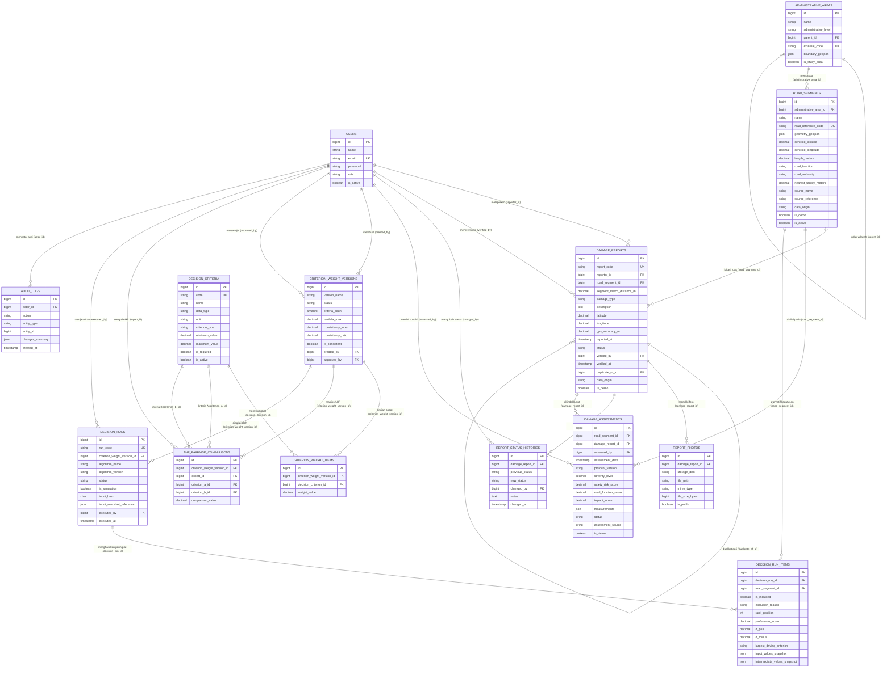

# Entity-Relationship Diagram (`ERD.md`)

**Tahap:** PRD 02 — Database Design & API Contract  
**Database:** MySQL / MariaDB 10.4.32 (`roadpriority` untuk development, `roadpriority_test` untuk pengujian otomatis)

---

## 1. Diagram Relasi Entitas (Mermaid `erDiagram`)

---

## 2. Ringkasan Kardinalitas & Kebijakan Penghapusan (`ON DELETE`)

| Relasi Induk $\rightarrow$ Anak | Foreign Key | Nullable | `ON DELETE` | Alasan Desain & Audit |
|---|---|---|---|---|
| `administrative_areas` $\rightarrow$ `administrative_areas` | `parent_id` | Ya | `SET NULL` | Hierarki administratif opsional (PRD 02 §4.3). |
| `administrative_areas` $\rightarrow$ `road_segments` | `administrative_area_id` | Ya | `SET NULL` | Ruas jalan tetap tersimpan meskipun batas wilayah diperbarui. |
| `road_segments` $\rightarrow$ `damage_reports` | `road_segment_id` | Ya | `SET NULL` | Laporan awal dapat masuk sebelum *map-matching* dikonfirmasi petugas. |
| `damage_reports` $\rightarrow$ `report_photos` | `damage_report_id` | Tidak | `CASCADE` | Metadata foto melekat langsung pada laporan induknya. |
| `damage_reports` $\rightarrow$ `report_status_histories` | `damage_report_id` | Tidak | **`RESTRICT`** | Mencegah penghapusan laporan yang sudah memiliki jejak riwayat status (PRD 02 §5 & §11). |
| `road_segments` $\rightarrow$ `damage_assessments` | `road_segment_id` | Ya* | **`RESTRICT`** | Ruas yang sudah memiliki penilaian kondisi lapangan tidak boleh dihapus. (*Minimal satu dari `road_segment_id` atau `damage_report_id` wajib terisi). |
| `decision_criteria` $\rightarrow$ `criterion_weight_items` | `decision_criterion_id` | Tidak | **`RESTRICT`** | Kriteria yang pernah dipakai pada versi bobot tidak boleh dihapus. |
| `criterion_weight_versions` $\rightarrow$ `decision_runs` | `criterion_weight_version_id` | Tidak | **`RESTRICT`** | Versi bobot yang sudah dipakai oleh eksekusi keputusan tidak boleh dihapus. |
| `decision_runs` $\rightarrow$ `decision_run_items` | `decision_run_id` | Tidak | `CASCADE` | Item hasil merupakan bagian dari satu kesatuan eksekusi `decision_runs`. |
| `road_segments` $\rightarrow$ `decision_run_items` | `road_segment_id` | Tidak | **`RESTRICT`** | Ruas jalan yang pernah menjadi alternatif dalam histori keputusan tidak boleh dihapus. |
| `users` $\rightarrow$ seluruh tabel transaksi/histori | `reporter_id`, `verified_by`, `changed_by`, `assessed_by`, `created_by`, `approved_by`, `expert_id`, `executed_by`, `actor_id` | Ya | `SET NULL` | Jika akun pengguna dinonaktifkan/dihapus, seluruh histori laporan, penilaian, bobot, keputusan, dan audit log tetap utuh. |

