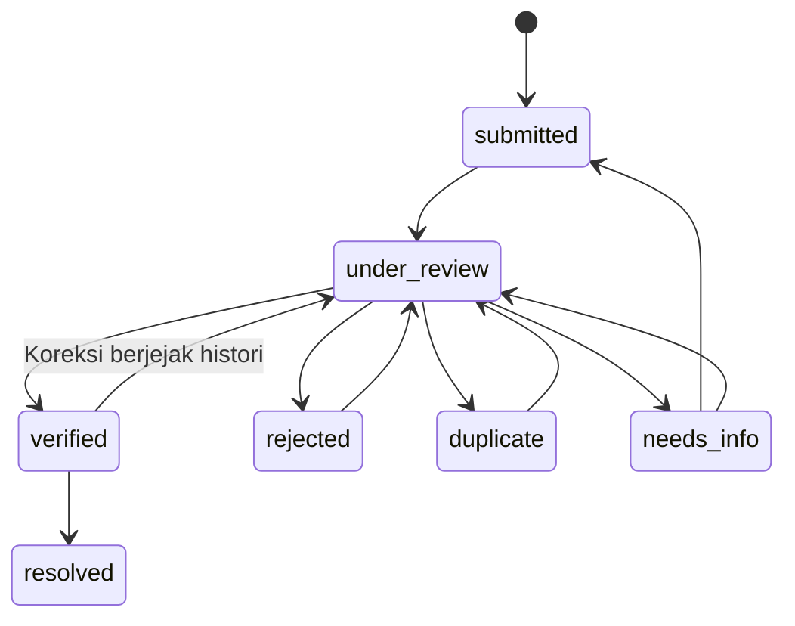

# Modul Pelaporan Kerusakan Jalan (`REPORTING_MODULE.md`)

**Tahap:** PRD 04 — Road Damage Reporting & WebGIS  
**Backend:** Laravel REST API (`DamageReportService`, `ReportStatusService`, `GeoGeometryService`, `ReportAccessController`)  
**Frontend:** React + Vite (`ReportForm.jsx`, `ReportDetailModal.jsx`, `HomePage.jsx`)

---

## 1. Pemisahan Konseptual Entitas (PRD 04 §1 & §8)

Sistem RoadPriority secara ketat memisahkan tiga entitas berikut:
1. **Laporan Kerusakan (`damage_reports`):** Informasi kejadian atau kondisi jalan yang dikirim oleh pengguna (`reporter`, `officer`, `admin`) pada satu titik koordinat (`latitude`, `longitude`) beserta foto bukti (`report_photos`) dan riwayat status (`report_status_histories`).
2. **Segmen Jalan (`road_segments`):** Representasi ruas jalan (`LineString` GeoJSON) yang menjadi alternatif unit analisis pemantauan dan prioritas perbaikan jalan.
3. **Penilaian Kondisi Jalan (`damage_assessments`):** Hasil pemeriksaan/asesmen lapangan terstruktur (protokol `SDI-ADAPTED-1.0`) yang akan menjadi input matriks keputusan AHP-TOPSIS pada PRD 05.

> **Aturan Relasi:** Satu segmen jalan dapat memiliki banyak laporan kerusakan (`1:N`), dan sebuah laporan baru **boleh disimpan tanpa `road_segment_id` (`null`)** sampai diverifikasi dan dihubungkan oleh petugas. Sistem tidak pernah membuat segmen jalan palsu secara otomatis hanya untuk mengisi foreign key.

---

## 2. Alur Pengiriman Laporan & Nomor Laporan Unik

### 2.1 Field Laporan (`POST /api/reports`)
- `damage_type` (`required`): Kategori awal yang dapat dikonfigurasi pada [`backend/config/reporting.php`](../backend/config/reporting.php):
  - `lubang` / `berlubang` — Lubang (*Pothole*)
  - `retak` — Retak (*Crack*)
  - `permukaan_bergelombang` — Permukaan Bergelombang
  - `aspal_mengelupas` — Aspal Mengelupas
  - `kerusakan_tepi_jalan` — Kerusakan Tepi Jalan
  - `lainnya` — Lainnya
  *(Catatan: Daftar awal ini adalah klasifikasi pelaporan awal dan bukan klasifikasi ilmiah final tanpa verifikasi lapangan).*
- `description` (`required`, 10–1000 karakter): Deskripsi kondisi kerusakan dan patokan lokasi.
- `latitude` (`required`, numerik $[-90, 90]$) & `longitude` (`required`, numerik $[-180, 180]$).
- `gps_accuracy_m` (`nullable`, numerik $0\text{–}5000\text{ m}$).
- `photos[]` (`nullable`, maks 5 file gambar @ maks 5 MB).

### 2.2 Penentuan Lokasi di Frontend (`ReportForm.jsx`)
Pengguna dapat menentukan lokasi melalui dua cara:
1. **Lokasi Perangkat (GPS):** Tombol *"Gunakan Lokasi Perangkat (GPS)"* memanggil `navigator.geolocation.getCurrentPosition`. Jika izin ditolak atau perangkat tidak mendukung GPS, sistem menampilkan pesan jelas tanpa mengunci formulir.
2. **Manual di Peta / Input Koordinat:** Mengklik titik pada peta Leaflet, menggeser marker pin 📍, atau mengetik koordinat secara langsung.

### 2.3 Kode Laporan Unik Server (`report_code`)
- Dibuat secara otomatis di server oleh [`DamageReportService::generateUniqueReportCode()`](../backend/app/Services/DamageReportService.php) dengan format `RPT-YYYYMMDD-XXXXXX` (6 karakter alfanumerik acak huruf besar, mis. `RPT-20261029-8F3K9A`).
- Dijamin unik melalui pemeriksaan aplikasi dan *unique index* database `uq_damage_reports_report_code`.
- Tidak mengandung informasi pribadi pelapor dan mengabaikan input `report_code`, `status`, atau `reporter_id` yang dikirim dari sisi klien.

---

## 3. Siklus Hidup Status (State Machine) & Histori Atomik

### 3.1 Transisi Status yang Sah (`ReportStatusService::ALLOWED_TRANSITIONS`)

- **`verified`** berarti laporan telah diperiksa kebenarannya oleh petugas dan layak ditampilkan di peta publik, **bukan** berarti jalan sudah diperbaiki.
- **`resolved`** berarti penanganan fisik kerusakan telah selesai diverifikasi.
- **`duplicate`** wajib menyertakan `duplicate_of_id` (ID laporan acuan) dan `notes`, serta menolak referensi ke dirinya sendiri (`409 Conflict`).
- Transisi ke `rejected`, `duplicate`, `needs_info`, dan `resolved` wajib menyertakan `notes` (`422 Unprocessable Entity` jika kosong).

### 3.2 Transaksi Atomik & Jejak Koreksi
Setiap perubahan status di [`ReportStatusService::transition()`](../backend/app/Services/ReportStatusService.php) dieksekusi di dalam `DB::transaction()` yang secara atomik:
1. Memperbarui status, `verification_notes`, `road_segment_id`, `segment_match_distance_m`, dan `duplicate_of_id` pada `damage_reports`.
2. Memperbarui `is_public` pada `report_photos` (`true` saat `verified`, ditarik kembali ke `false` jika dikoreksi kembali ke `under_review`).
3. Menambahkan baris baru (*append-only*) ke `report_status_histories` (tidak pernah menghapus histori lama).
4. Mencatat aksi `report.status_changed` ke `audit_logs`.

---

## 4. Keamanan Upload Foto (`PRD 04 §5`)

1. **Validasi Berlapis:**
   - Validasi Form Request (`StoreDamageReportRequest`): `mimetypes:image/jpeg,image/png,image/webp`, maks `5120` KB (5 MB) per file, maks 5 file per laporan.
   - Validasi isi biner (`DamageReportService::createReport`): memeriksa header gambar menggunakan `getimagesize()` dan memastikan dimensi lebar/tinggi $> 0$ serta MIME terdeteksi sesuai daftar izin. File skrip (mis. `.php` yang diubah namanya menjadi `.jpg`) langsung ditolak dengan `422`.
2. **Penyimpanan Privat & Nama File UUID:**
   - File disimpan pada disk privat `local` (`storage/app/report-photos/{YYYY}/{MM}/{uuid}.{ext}`), **di luar** folder `public/`.
   - Nama file asli dari pengguna tidak pernah dipakai sebagai path penyimpanan.
   - Hash `sha256`, dimensi (`width`, `height`), ukuran byte, dan MIME disimpan di tabel `report_photos`.
3. **Pembersihan File Yatim (*Orphan File Cleanup*):**
   - Jika terjadi kegagalan di tengah transaksi database setelah file ditulis ke disk, blok `catch (Throwable $e)` di `DamageReportService::createReport` secara otomatis menghapus seluruh file yang baru ditulis pada request tersebut.

---

## 5. Bantuan Verifikasi Petugas (`PRD 04 §6`)

Saat petugas (`officer` atau `admin`) membuka detail laporan (`GET /api/reports/{id}`), [`GeoGeometryService`](../backend/app/Services/GeoGeometryService.php) menyertakan:
1. **`suggested_segments`:** Daftar segmen jalan aktif dalam radius $\le 50\text{ m}$ beserta jarak titik-ke-garis (`distance_meters`) untuk membantu petugas memilih segmen jalan secara akurat.
2. **`nearby_duplicate_candidates`:** Daftar laporan lain dalam radius $\le 50\text{ m}$ dan rentang waktu $\pm 30\text{ hari}$ untuk membantu pemeriksaan duplikat secara manual (sistem tidak pernah menandai duplikat secara otomatis hanya karena berdekatan).
3. **`study_area_check`:** Status apakah koordinat berada di dalam poligon/kotak referensi wilayah studi BSD/Tangerang.

